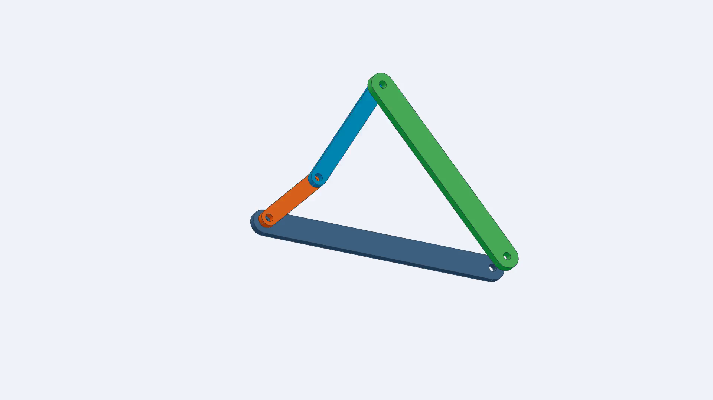
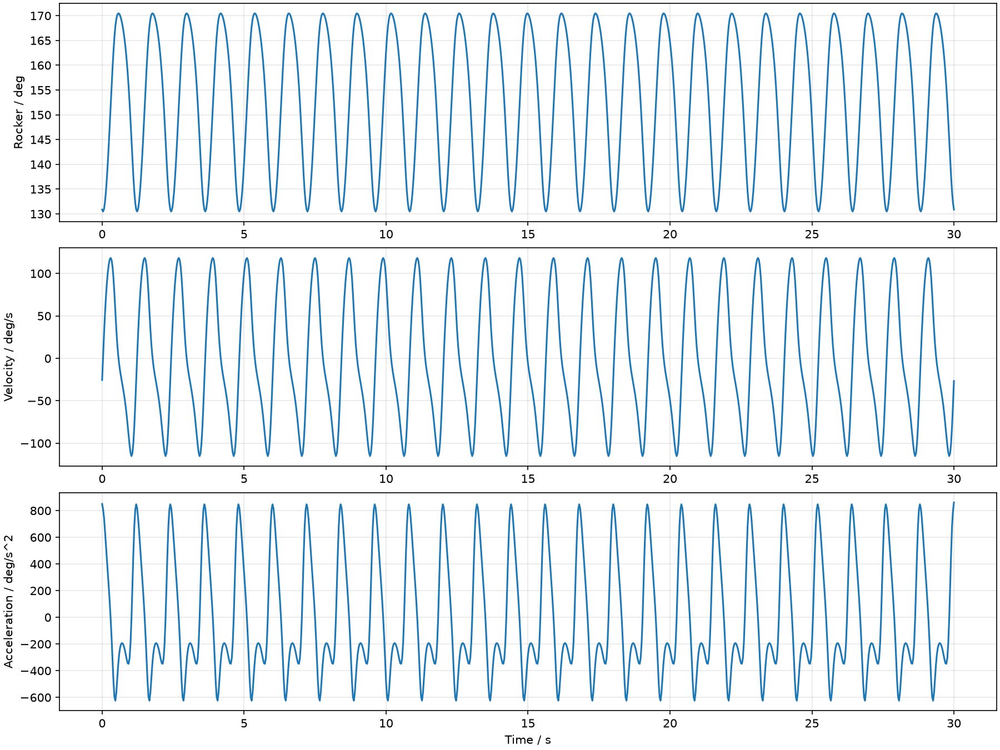

# mechanism-to-cad

**机械结构智能建模与运动仿真系统 · Windows Codex Agent Skill**

从机械图片、草图或结构描述出发，核对尺寸与运动拓扑，生成可编辑CAD零件、真实装配配合、闭环运动数据和工程动画。

**V1 完整验收范围是平面四杆机构 + SOLIDWORKS。** 视觉分析由 Codex 协助完成；脚本不会凭照片比例推断准确尺寸，也不会把独立旋转动画冒充机构仿真。

| 短连杆方案 | 长连杆方案 |
|---|---|
|  |  |
| [30秒运动演示](examples/short_fourbar/animation.mp4) · [验收摘要](examples/short_fourbar/validation_summary.json) | [30秒运动演示](examples/long_fourbar/animation.mp4) · [验收摘要](examples/long_fourbar/validation_summary.json) |

## 功能

- 平面四杆尺寸综合：从已知机架、摇杆、摆角及行程速比枚举有效杆长；多解需用户选择。
- 圆交点闭环求解：分支连续性、整周可行性、死点、闭合误差和传动角检查。
- 原生SOLIDWORKS零件：完全定义的草图、方程驱动尺寸、拉伸和通孔特征。
- 真实装配：固定机架、四个同心配合及三个轴向定位配合。
- 实际Motion Analysis：创建电机、计算、与独立求解器比对，并保存后重开验证缓存结果。
- 输出STEP、STL、运动CSV、曲线、逐帧求解数据和MP4；默认1920×1080、30FPS。
- 使用已安装的text-to-CAD / cadgen进行几何交换、场景输出和工程渲染。

## 环境

参考验收环境：Windows、Python3.11、SOLIDWORKS2025 SP5、cadgen0.7.10、build123d0.11.1、FFmpeg8.1.1。

需要本机可用的SOLIDWORKS及Motion Analysis，Python依赖见[requirements.txt](requirements.txt)。FFmpeg/ffprobe须可从PATH调用，cadgen快照需要其支持的Chromium环境。

FreeCAD和Blender不是V1的已实现后端。不要仅凭导出STEP就认为保留了可编辑的原生装配约束。

## 安装到Codex

先克隆仓库，优先复用已经具备依赖的Python环境。以下命令中的`python`应指向该解释器；不确定时先执行环境检测。

```powershell
git clone https://github.com/2508826533q-cyber/mechanism-to-cad.git
cd mechanism-to-cad
python scripts/check_environment.py --out environment_detected.json
```

如果需要独立的新Python环境，可选择：

```powershell
py -3.11 -m venv .venv
.\.venv\Scripts\python.exe -m pip install -r requirements.txt
.\.venv\Scripts\python.exe -m playwright install chromium
```

如果创建了上述虚拟环境，后续命令中的 `python` 请使用 `.\.venv\Scripts\python.exe`。

不要为运行此Skill重复安装已有CAD软件。用选定的Python配置实际路径，再安装Skill：

```powershell
python scripts/configure_environment.py --solidworks-install 'C:\Program Files\SOLIDWORKS Corp\SOLIDWORKS'
python scripts/install_skill.py
```

目标是当前用户的 `%USERPROFILE%\.agents\skills\mechanism-to-cad`。安装器遇到已有同名Skill会停止；它不会自动覆盖其他版本或修改其他Skill。`.git`、虚拟环境、项目输出和运行日志不会被复制。

本机配置写入`local_environment.json`，已在Git忽略规则中排除。也可以用`MECHANISM_PYTHON`、`MECHANISM_SW_INSTALL`指定实际解释器及SolidWorks目录。不要移动或删除仍被配置引用的Python环境。

## 在Codex中使用

将JPG、PNG或WEBP图片拖入聊天，并输入：

> 使用 $mechanism-to-cad 分析这张机械图片，核对已知尺寸和连接关系，建立三维零件、装配体并生成运动仿真。

同时提供已知**孔中心距**、孔径/厚度、固定件、驱动件、转速、时间及输出格式。单张图片不能可靠确定隐藏结构与全部尺寸；关键条件不足时，Skill会请求补充。可允许概念假设，但必须明确标注。

也可以直接运行脚本：

```powershell
$skillDir = Join-Path $env:USERPROFILE '.agents\skills\mechanism-to-cad'
& "$skillDir\run.ps1" 'D:\Projects\MyMechanism' --parameters "$skillDir\assets\templates\acceptance_short.json"
```

模板中的短连杆方案是已选定的验收设计，不能作为所有项目的默认选择。详细输入格式和综合计算见[运动学说明](references/kinematics.md)。

长连杆方案使用独立模板和新的输出目录：

```powershell
& "$skillDir\run.ps1" 'D:\Projects\LongCoupler' --parameters "$skillDir\assets\templates\acceptance_long.json"
```

## 验收示例

AD=300mm、CD=250mm、摆角40°、K=1.2，有两组有效的曲柄摇杆杆长，不是唯一解：

| 方案 | AB / mm | BC / mm |
|---|---:|---:|
| [短连杆示例](examples/short_fourbar/) |83.60514904142842|151.17292022893315|
| [长连杆示例](examples/long_fourbar/) |65.63218169655732|390.6459004035889|

两者还存在镜像装配。两个示例分别以50RPM、30秒在参考Windows环境完成四个原生零件、七个真实配合、Motion Analysis及重开回放验证。视频均为900帧/30FPS的闭环求解工程演示；原生Motion Analysis缓存另以25FPS验证。两种方案的中位安装角不同，40°均指各自两个极限位置之间的总摆角，不能只替换旧装配中的杆长而保持旧配合位置。



原生装配输出在项目的 `assembly/*_Assembly.SLDASM`，准确文件名写入`reports/native_validation.json`。保留相邻的`parts/`目录，打开装配后选择 **Mechanism_Motion**。视频位于`animation/animation.mp4`。

示例公开了可复核的数值摘要、参数、预览和视频；未上传原开发电脑的路径、账号配置或原始运行日志。原生CAD由工作流在使用者本机生成。

## 测试

```powershell
python -m unittest discover -s tests -v
```

16项自动测试覆盖两组综合解、长方案30秒完整求解、尺寸矛盾、缺失条件、镜像、闭环、反向运动、分支连续性、另一组四杆尺寸、图片接口和失败输出。GitHub Actions仅运行数学/接口测试；不能替代安装了SOLIDWORKS的Windows本机端到端验收。

## 当前边界

未实现独立视觉分割、任意导入零件自动配合、FreeCAD原生装配后端、Blender产品渲染、齿轮/凸轮/滑块/空间机械臂的完整工作流。运动学验证也不代表已完成有限元、材料强度或打印工艺验证。四个主要杆件不包括销轴、轴承、垫片和紧固件。

[Skill入口](SKILL.md) · [架构](references/architecture.md) · [CAD后端](references/cad_backends.md) · [故障处理](references/troubleshooting.md)
