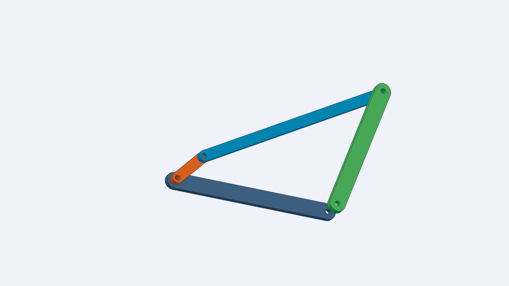
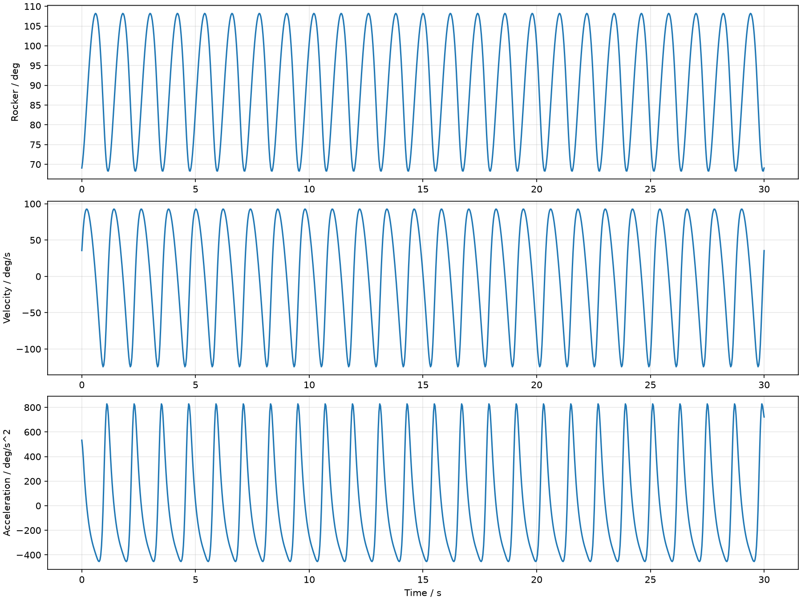

# 长连杆方案 / Long coupler



[观看30秒运动演示](animation.mp4) · [验证数据](validation_summary.json) · [输入参数](parameters.json)

| 参数 | 值 |
|---|---:|
| AD |300 mm|
| AB |65.63218169655732 mm|
| BC |390.6459004035889 mm|
| CD |250 mm|
| 摆角 |40°|
| K |1.2|
| 输入 |50 RPM、30秒|

这组杆长是从AD、CD、摆角和K重新综合的长连杆解，未使用65.6/390.6的取整值。
A=(0,0)、D=(300,0)，使用上侧闭环分支；摇杆两个极限角为68.2063711424°与108.2063711424°，相对中位各±20°。

已在Windows参考环境独立执行四个原生零件生成、七个真实配合、Motion Analysis、原生计算姿态比对、保存重开回放、STEP/STL几何检查及视频完整解码。
演示视频是闭环求解位姿表驱动的工程渲染，1920×1080、30FPS、900帧；原生Motion Analysis缓存另以25FPS验证。

从已配置的Skill运行（请使用新项目目录）：

```powershell
$skillDir = Join-Path $env:USERPROFILE '.agents\skills\mechanism-to-cad'
& "$skillDir\run.ps1" 'D:\Projects\LongCoupler' --parameters "$skillDir\assets\templates\acceptance_long.json"
```

原生CAD在本机生成于`parts/`和`assembly/`；准确SLDASM文件名见项目的`reports/native_validation.json`。打开装配，选择 **Mechanism_Motion** 回放。
本目录不包含原开发电脑的个人路径或运行配置。



与[短连杆方案](../short_fourbar/)相比，两者满足同样的摆角与K，但杆长和中位安装角不同。
四主体不包括销轴和紧固件；运动学检查不等同于承载或有限元验证。
